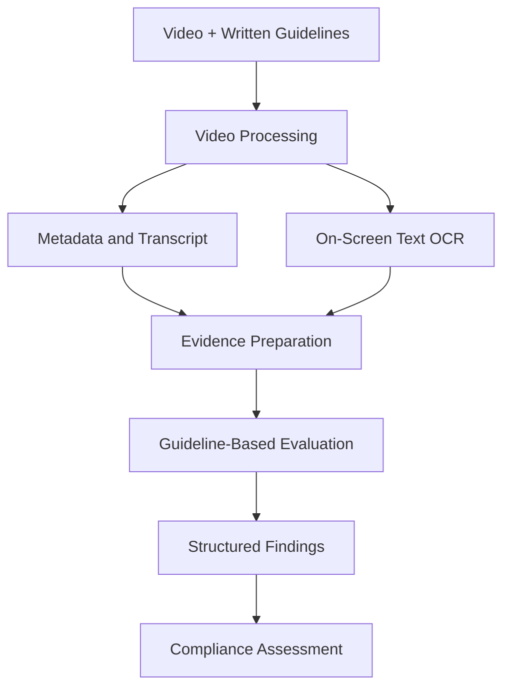

# ComplianceQAPipeline
### AI-Powered Video Compliance & Content Auditing

**Turn written guidelines into a structured video compliance review.**

ComplianceQAPipeline is an AI engineering project designed to evaluate video content against a set of predefined rules, policies, or brand guidelines. It brings together video analysis, language models, and workflow orchestration to help identify potential compliance issues and produce structured review results.

Instead of manually reviewing every second of a video against a lengthy document, the goal is to build a pipeline that extracts relevant evidence, compares it with the applicable guidelines, and generates an auditable assessment.

> **Project status:** In development. Some integrations and workflow components may require additional configuration.

## The Problem

Organizations often need to verify that video content complies with internal policies, advertising requirements, or brand guidelines before publication.

Manual reviews can be time-consuming, inconsistent, and difficult to scale. At the same time, a language model evaluating a video without access to the relevant evidence or written requirements can produce unreliable conclusions.

This project explores a more structured approach: **ground compliance decisions in extracted video evidence and explicit written requirements.**

## Key Features

- **Video analysis:** Process a video and collect relevant information from its available metadata and extracted content.
- **Multimodal evidence extraction:** Work with video transcripts and on-screen text obtained through OCR, with support for additional video-analysis integrations.
- **Guideline-based evaluation:** Compare extracted evidence against a set of written compliance requirements.
- **AI workflow orchestration:** Organize processing and evaluation steps into a structured workflow using LangGraph.
- **Structured results:** Represent findings, errors, and the overall compliance assessment in a machine-readable format.
- **Extensible architecture:** Separate the API, processing services, and application logic to support future integrations and improvements.

## How It Works

The intended workflow follows these stages:

1. **Input:** Provide a video and the relevant compliance guidelines.
2. **Extraction:** Collect available video metadata, transcript information, and on-screen text.
3. **Evidence preparation:** Organize the extracted information into a format suitable for evaluation.
4. **Compliance assessment:** Compare the evidence with the applicable requirements using an AI-driven workflow.
5. **Result generation:** Produce a structured assessment that can support further review.



*The diagram represents the intended pipeline; the availability of each stage depends on the configured integrations.*

## Technology Stack

| Area | Technologies |
|---|---|
| Language | Python |
| AI orchestration | LangChain, LangGraph |
| API layer | FastAPI |
| Application interface | Streamlit |
| Video processing | yt-dlp and configurable video-analysis services |
| Text extraction | Transcript processing and OCR |
| Cloud integrations | Azure services, where configured |
| Development tools | Git, virtual environments, environment variables |

## Project Structure


The structure may evolve as the application is developed. The backend contains the API and related services, while the root entry point and project configuration support application startup and dependency management.

## Getting Started

### Prerequisites

- Python version compatible with the project dependencies
- Git
- [uv](https://docs.astral.sh/uv/) for dependency and environment management
- Credentials for any external services enabled in your configuration

### 1. Clone the repository

```bash
git clone https://github.com/HadBeen/ComplianceQAPipeline.git
cd ComplianceQAPipeline
```

### 2. Install dependencies

```bash
uv sync
```

### 3. Configure environment variables

Create a local `.env` file if required by the application. Add only the credentials and configuration values used by your enabled integrations.

For example:

```env
# Add the environment variables required by your configuration.
# Keep real credentials out of version control.
```

Check the relevant service configuration before starting the application. Azure resources and other external integrations may require additional setup and permissions.

### 4. Run the application

The repository currently has a root entry point and a backend API entry point. Use the entry point corresponding to the component you want to test:

```bash
uv run python main.py
```

For the backend API, if its module imports and configuration are ready:

```bash
uv run python -m src.api.server
```

Run the backend command from the directory where the `src` package is importable. The exact startup command may need to be adapted to the current package layout.

## Design Principles

**Evidence before conclusions**

Compliance assessments should be based on information extracted from the video and the requirements being evaluated, rather than unsupported model assumptions.

**Structured workflows**

Separating extraction, evaluation, and result generation makes the pipeline easier to test, debug, and extend.

**Traceability**

A useful compliance system should make it possible to understand which evidence supports a finding and which requirement it relates to.

**Graceful failure handling**

External video services, OCR, and AI APIs can fail. The pipeline should capture errors and avoid treating missing evidence as proof of compliance.

## Current Limitations

This project is actively being developed. Its reliability depends on the availability and configuration of external services, the quality of extracted video information, and the implementation of the evaluation workflow.

An AI-generated compliance assessment should be treated as decision support rather than a guarantee of legal or policy compliance. Human review remains important for ambiguous or high-impact decisions.


## About

Developed by **Hadjer Benali**, AI Engineer and Data Scientist.

This project explores the intersection of multimodal AI, workflow orchestration, and evidence-based automated evaluation.


- **Tutorial:** Krish NAIK

